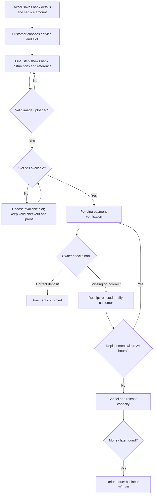

# Bank deposit receipt bookings

## Intent

Businesses using spaces, professional services, and open events can require a bank or cash deposit receipt before a customer submits a booking. Restaurants and invitation-only RSVPs are excluded. Customers remain account-free. A receipt is evidence for manual review, never proof of payment by itself.

## Customer flow

The final details step shows the exact structured amount, currency, bank identifiers, and reference. Confirm stays disabled until an image upload is complete and validated by the server. Submission creates a slot-consuming booking pending payment verification. The existing private booking link shows pending, rejected, or confirmed payment state and accepts a replacement receipt after rejection.

The existing hold is ten minutes, with one five-minute extension. Bank trips can outlast it. A resumable checkout preserves the reference and uploaded proof without preserving the slot. On return, the customer must select an available slot again. The checkout snapshots amount and bank instructions, so later edits do not invalidate an already issued reference.

## Business flow

An owner configures one bank account and deposit instructions, then enables deposits on eligible services with a structured full price. Owner sees uploaded receipt on the booking, checks the actual bank account, then confirms payment or rejects with a reason. Rejection starts a 24-hour correction period when customer notification succeeds. Owner delay before review never starts that period. Business handles refunds; Haab records `refund_due` and lets owner mark refund completed.

## State and inventory

Booking state and payment state remain distinct. Pending verification and correction-required bookings occupy slots, event capacity, and daily limits. Rescheduling preserves payment state. A pending booking syncs to Google Calendar as a private busy event labeled payment pending; confirmation updates it. Customer and provider emails distinguish slot reservation from verified payment.

## Price and storage

Existing free-text service costs cannot determine deposit amounts. Eligible services require numeric price in minor units and an ISO currency code. Price and bank instructions are snapshotted into the payment request. Receipt images live in private storage with server-checked, scoped uploads and owner-only short-lived reads. No receipt is attached to email or calendar events.

## Retention

All submitted image attempts, including rejected and replaced images, remain for twelve calendar months from the later of service date or payment resolution. For cases still unresolved, the twelve-month clock starts at service date; alert owner before deletion. Twelve months is a hard maximum. Unattached staged uploads expire shortly after checkout expiry. Booking-history retention may be shorter; payment records and images must therefore have their own lifecycle. Delete objects through storage API, then their metadata, with retry and orphan reconciliation. Update privacy notices in both languages before release.

## Release boundaries

MVP supports one bank account, full-price deposit, one receipt image per attempt, manual review, replacement, and existing public booking types. OCR, automatic matching, multiple accounts, partial deposits, and automatic refunds wait.

## Detailed journeys

**Setup:** Owner opens Settings > Bank deposits on an eligible business; enters bank name, account holder, ISO country/currency codes, at least one of account number/CLABE/IBAN, optional SWIFT/BIC and routing code, and English/Spanish instructions. Owner saves and enables account, then enables deposit receipt per service with exact structured amount. Existing payment requests keep account and amount snapshot when settings change.

**Customer:** Choose service/date/time. Final step shows amount, reference, bank details, instructions, and copyable return link. Upload one JPEG, PNG, or WebP; server validates stored file before returning a proof ID. Confirm stays disabled until proof ID exists. Server rechecks checkout, proof, date, and inventory; booking plus submitted proof commit in one transaction. Customer receives pending email and private link. Bank trip may outlast 10-minute hold and one 5-minute extension: return link restores checkout and uploaded proof for up to 72 hours, but customer must choose available slot again. Expired checkout needs new reference and upload. Duplicate Confirm returns existing booking.

**Review:** Owner sees amount/reference and receipt history, checks bank app, then confirms or rejects with required reason. Confirmation marks booking fully confirmed. Rejection email starts 24-hour correction period once accepted for delivery. Customer private link shows reason/deadline and accepts a replacement; earlier attempts remain for audit. Expired correction cancels booking and frees capacity. If deposit arrives after a pending booking was cancelled, owner records `refund_due`, handles refund outside Haab, then records `refunded`.

## Entity and status contract

| Entity | Key fields | Purpose |
| --- | --- | --- |
| `business_bank_accounts` | `provider_id`, `bank_name`, `account_holder`, `country_code`, `currency_code`, `account_number`, `clabe`, `iban`, `swift_bic`, `routing_code`, `instructions_en`, `instructions_es`, `enabled` | One private account per business in MVP. |
| `services` | `deposit_required`, `deposit_amount_minor`, `deposit_currency_code` | Exact amount per service; existing free-text display price remains separate. |
| `payment_requests` | `provider_id`, `service_id`, `booking_id`, `service_date`, `amount_minor`, `currency_code`, `reference`, `account_snapshot`, `checkout_token_hash`, `status`, `expires_at`, `correction_deadline`, `resolved_at`, `delete_after`, `delete_at`, `deletion_notice_sent_at` | Checkout snapshot and business-local retention cutoff, independent of booking-history cleanup. |
| `payment_proofs` | `payment_request_id`, `storage_path`, `mime_type`, `byte_size`, `sha256`, `status`, `uploaded_at`, `submitted_at`, `reviewed_at`, `reviewed_by`, `rejection_reason`, `customer_notice_sent_at` | Every submitted attempt, including rejected replacements. |
| `payment_receipt_upload_intents` | `payment_request_id`, `storage_path`, `issued_at`, `completed_at` | Track signed uploads and clean orphan files. |
| `bookings` | `status`, `payment_status`, `payment_request_id`, `payment_proof_id`, `amount_due_minor`, `currency_code`, `payment_verified_at`, `payment_verified_by` | Current booking and payment projection. |
| `payment_events` | `payment_request_id`, `provider_id`, `actor_type`, `actor_user_id`, `event_type`, `metadata`, `created_at` | Payment audit; existing `booking_events` tracks booking changes. |

Booking statuses: `confirmed`, `rescheduled`, `cancelled`, `pending_payment_verification`, `payment_action_required`. Payment statuses: `pending_verification`, `receipt_rejected`, `payment_confirmed`, `refund_due`, `refunded`. Proof statuses: `staged`, `submitted`, `superseded`, `rejected`, `accepted`. Request additionally has `checkout_open`. A cancelled booking may still have `refund_due`.

## Screens and communication

| Surface | Content and action |
| --- | --- |
| Owner settings | Bank identifiers, instructions, account toggle, service toggle, exact amount. |
| Customer final step | Amount/reference, bank details, return link, mobile camera/file picker, upload progress/error, disabled Confirm until proof exists. |
| Owner booking list | Pending badge, amount/reference, receipt attempts, confirm/reject actions, refund tracking. |
| Customer private link | Pending, rejected with reason/deadline, or confirmed payment status; replacement, reschedule, and cancel controls. |

Booking-created email says receipt received and booking pending; it never says payment confirmed. Review email says payment confirmed or gives rejection reason and 24-hour correction instructions. Existing booking email carries private link. Owner sees booking in admin and existing notifications; image is never attached to email. Thirty-day deletion warning gives date and reference for export. Customer-facing status and settings support English and Spanish.

## Operations and later phases

Browser uploads to a private Supabase Storage bucket through scoped signed path. Bucket/server enforce 10 MB and JPEG/PNG/WebP; server checks signature, decodes pixels under a pixel limit, and stores a hash before staging. Owner-only endpoint creates five-minute signed read URLs. Checkout capability is random and hashed in Postgres; owner review uses authenticated ownership checks. Pending and correction-required bookings consume exclusive slots, event capacity, and daily limits.

Daily scheduled worker sends deletion notice, deletes expired objects through Storage, then removes metadata; failures retry. It also clears abandoned checkouts, stale staged proofs, upload intents, and expired correction periods. Workflow drains bounded batches. Calendar gets private busy pending events, never receipt or bank details. Amounts use minor units and ISO currencies; account and service currencies must match. One amount applies per booking in MVP. Future online payment methods can share booking/payment state with separate verification adapters.

Later phases: OCR, bank matching, multiple bank accounts, partial deposits, automatic refunds, and group ticket pricing rules. Before production enablement, assign owner for failed email/retention monitoring, review legal text per launch country, decide on bulk receipt export, and define group event ticket pricing when multi-seat checkout is offered. Deployment needs migrations, private bucket, email credentials, `REMINDER_LINK_SECRET` for signed private email links, and scheduled workers.
